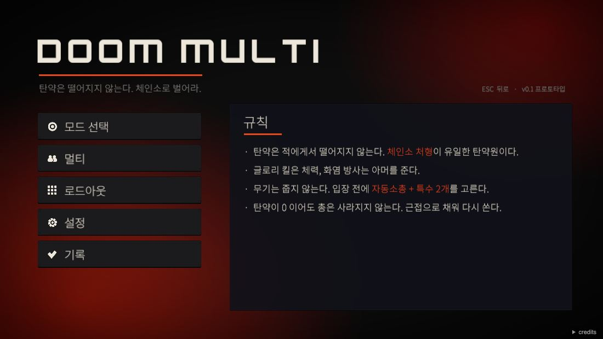

안녕하세요, 양정운입니다.

개발자 꿈나무, AI를 통해 발전하고 싶은 사람입니다.

요즘 만든 것들 올려 둘게요. 더 자세한 건 [포트폴리오](https://yangjungun05-prog.github.io/portfolio/)에 있어요.

## 취약 돌보미

[저장소](https://github.com/yangjungun05-prog/isolation-care-public)

빅콘테스트에 둘이서 낸 프로젝트예요. 복지 담당자가 어느 동부터 챙겨야 할지 자료로 볼 수 있게 만들었고, 저는 대시보드랑 시뮬레이션을 맡았어요.
대회 자료는 공개할 수 없어서, 공개 자료로 다시 만든 판을 올렸습니다. 어디까지 맞고 어디서 틀리는지도 README에 적어 뒀어요.

## 선행퀘스트

[저장소](https://github.com/QuestismTeam/GoodDeedQuest)

<table>
<tr>
<td width="280"></td>
<td>

다섯 명이 같이 만든 앱이에요. 좋은 일을 하고 영상을 올리면 AI가 진짜 했는지 보고 포인트를 줍니다.

저는 로그인, 퀘스트 만들기, 인증을 맡았어요. 옛날 영상이나 남의 영상을 재탕하는 걸 막는 부분도 여기 들어갑니다.

앱 화면 코드는 대부분 AI 에이전트가 썼고, 저는 그걸 하나로 합치고 고쳤어요.

움짤에 AI한테 거절당하는 장면도 그대로 넣었습니다.

</td>
</tr>
</table>

## DoomMulti

[바로 해 보기](https://yangjungun05-prog.github.io/doom-multi-web/)

혼자 만들고 있는 게임이에요. 탄약이 안 떨어져서 체인소로 벌어야 합니다. 아직 프로토타입이고, 웹 빌드는 로딩이 좀 길어요.

## Reclaim

[저장소](https://github.com/yangjungun05-prog/reclaim)

제가 매일 쓰려고 만든 맥 저장 공간 정리 앱이에요. 용량을 어디에 쓰는지 보여 주고, 지워도 되는 파일을 찾아 줍니다. 파일은 휴지통으로만 옮겨서 되돌릴 수 있어요.

코드는 Claude Code로 썼어요. 움짤은 가짜 파일로 찍었습니다.

## 미니 슬라이드

[저장소](https://github.com/yangjungun05-prog/mini-slides)

브라우저에서 바로 쓰는 슬라이드 편집기예요. `.pptx` 파일을 열어서 고친 곳만 저장할 수 있어요.

화면과 단축키는 PowerPoint를 참고했고, 코드는 Claude Code로 썼어요.

## 채팅 에이전트

[클라이언트](https://github.com/yangjungun05-prog/chat-agent-KDT2604-client) · [MCP 서버](https://github.com/yangjungun05-prog/chat-agent-kdt2604-server)

날씨, 뉴스, 야구 순위 같은 걸 물어보면 답해 주는 채팅이에요. 도구는 MCP로 붙였습니다.

## 자주 쓰는 것

