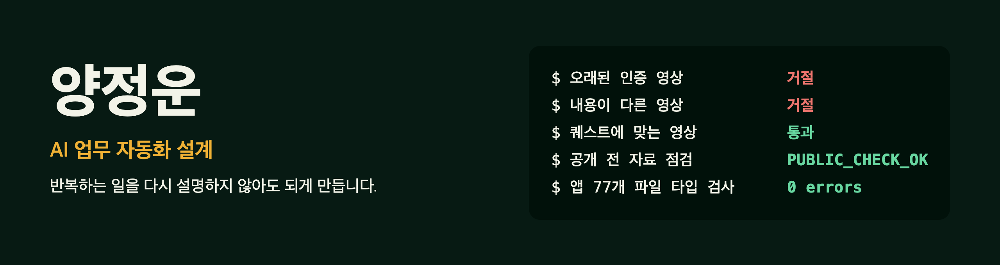

AI 에이전트로 빠르게 만들고, **구조 설계 · 통합 · 검증은 제가 맡습니다.**
"돌아간다"에서 멈추지 않고, 실패하는 경우까지 직접 돌려 보고 숫자와 한계를 함께 공개합니다.

[포트폴리오 사이트](https://yangjungun05-prog.github.io/portfolio/)

## 대표 프로젝트

### [취약 돌보미](https://github.com/yangjungun05-prog/isolation-care-public) · 동네 고립 살핌 서비스

복지 실무자가 "어느 동부터, 왜, 무엇을 하면 얼마나"를 자료로 판단하게 돕습니다. 2026 빅콘테스트 AI데이터 활용 분야 출품작을 공개 자료로 다시 만든 판입니다.

- **맡은 일:** 대시보드 · 시뮬레이션 · 고립 추정 · 개발 환경 (2인 팀)
- **확인한 것:** CI 테스트 1,067개 통과. 공개 전에 자료를 검사하는 스크립트를 두고, 규칙의 성능과 한계를 README에 숫자로 적었습니다.
- **기술:** Python · FastAPI · 시뮬레이션 · 공공 데이터

### [선행퀘스트](https://github.com/QuestismTeam/GoodDeedQuest) · 작은 선행을 퀘스트로 바꾸는 앱

<table>
<tr>
<td width="280"></td>
<td>

AI가 맞는 선행을 추천하고, 영상으로 인증하면 보상이 쌓이고, 기록이 숏폼으로 남습니다. 움짤에는 AI가 거절하는 장면도 그대로 담았습니다.

- **맡은 일:** 로그인 · 회원, 퀘스트 생성, AI 퀘스트 인증 (5인 팀)
- **인증 설계:** LangGraph로 단계를 잇고, 촬영 시각 · pHash 재탕 검사 · 손글씨 코드 재확인으로 악용을 막습니다.
- **앱 이식:** 에이전트 8개에게 화면을 나눠 맡긴 뒤 77개 파일 · 12,110줄을 하나로 통합했습니다. 화면 코드 대부분은 에이전트가 썼고, 저는 규격 · 통합 · 디버깅을 맡았습니다.
- **기술:** FastAPI · LangGraph · Gemini Vision · PostgreSQL · React Native · TypeScript

</td>
</tr>
</table>

### [DoomMulti](https://yangjungun05-prog.github.io/doom-multi-web/) · 1인칭 멀티 액션 게임

Unity로 만드는 v0.1 프로토타입입니다. 탄약이 떨어지지 않아 체인소 처형으로 벌어야 하는 규칙을 넣었습니다. 웹 빌드는 불러오는 데 시간이 걸립니다.

### [채팅 에이전트](https://github.com/yangjungun05-prog/chat-agent-KDT2604-client) · MCP 도구 연동

LangGraph ReAct 에이전트와 [MCP 서버](https://github.com/yangjungun05-prog/chat-agent-kdt2604-server)를 FastAPI 채팅으로 연결했습니다. 날씨 · 뉴스 · 일정 브리핑 도구를 직접 만들었습니다.

## 일하는 방식

- **규격 먼저, 그다음 에이전트.** 공통 규칙과 검사 조건을 먼저 정하고, 일은 단위로 나눠 맡깁니다.
- **대조군이 실패해야 검사입니다.** 통과만 보지 않고, 일부러 틀린 입력을 넣어 막히는지 봅니다.
- **실패도 공개합니다.** 안 되는 경우와 한계를 결과물에 함께 적습니다.

## 직접 만들어 본 기술

